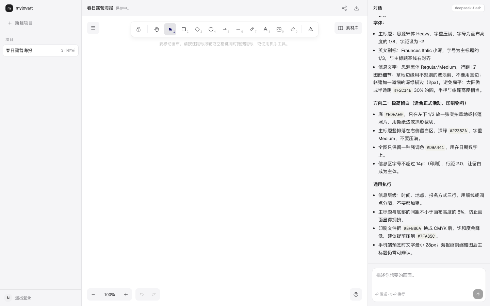

# My Lovart

**AI 设计画布。** 左边画布，右边对话。用自然语言描述，AI 生成图像并直接落到画布上。



## 状态

早期搭建中，路线见 [`docs/PLAN.md`](docs/PLAN.md)，视觉规范见 [`docs/DESIGN.md`](docs/DESIGN.md)。

## 技术栈

- 前端：Next.js (App Router) · React · Tailwind CSS · shadcn/ui · Excalidraw
- 后端：Fastify · WebSocket
- 数据：Supabase (Postgres · Auth · Storage)
- AI：OpenAI SDK + 自建 Agent loop
- 工程：pnpm workspace · Turborepo · Vitest · Biome

## 开发

```bash
pnpm install
cp apps/web/.env.local.example apps/web/.env.local   # Supabase 配置
pnpm dev
```

| 进程 | 端口 | 职责 |
|------|------|------|
| `apps/web` | 3000 | 工作区界面 |
| `apps/server` | 3001 | HTTP API（`/health`） |

## 结构

```
apps/web        前端
apps/server     后端
packages/shared 共用类型与 WS 协议
docs            计划、设计规范、里程碑笔记
```
