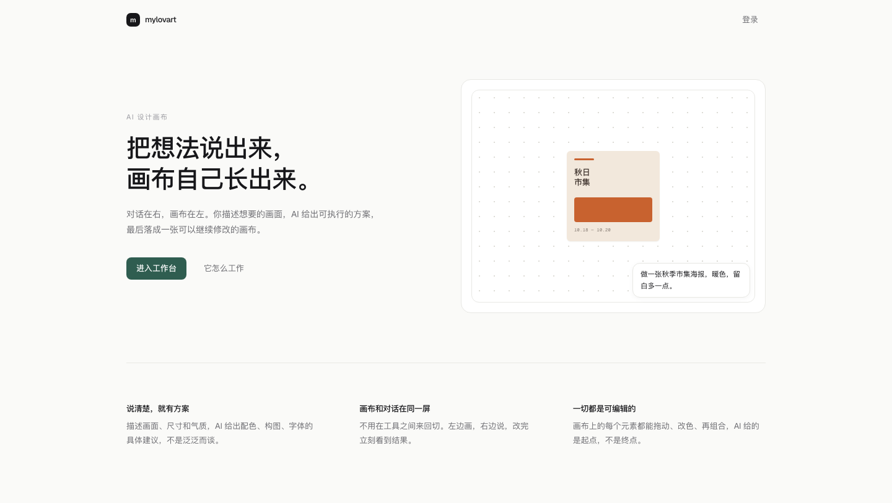

# My Lovart

**AI 创作画布。** 左边画布，右边对话。用一句话生成图像、视频和版式，直接落到画布上，接着改。



页面：`/` 首页（左侧介绍，右侧登录）· `/app` 工作台（未登录跳回首页）· `/login` 旧链接重定向到首页

## 状态

早期搭建中，路线见 [`docs/PLAN.md`](docs/PLAN.md)，视觉规范见 [`docs/DESIGN.md`](docs/DESIGN.md)。

## 技术栈

- 前端：Next.js 15 (App Router) · React 19 · Tailwind CSS 4 · Excalidraw · react-markdown
- 后端：Fastify 5（WebSocket 待接）
- 数据：暂时是服务端内存，迁移与 Supabase 客户端已就位
- AI：直接调 OpenAI 兼容接口（DeepSeek），自建 prompt 与上下文拼接
- 工程：pnpm workspace · Turborepo · TypeScript · Biome

## 开发

```bash
pnpm install
cp apps/web/.env.local.example apps/web/.env.local   # Supabase 配置
pnpm dev
```

| 进程 | 端口 | 职责 |
|------|------|------|
| `apps/web` | 3000 | 工作区界面 |
| `apps/server` | 3001 | HTTP API（`/health`） |

## 结构

```
apps/web        前端
apps/server     后端
packages/shared 共用类型与 WS 协议
docs            计划、设计规范、里程碑笔记
```
